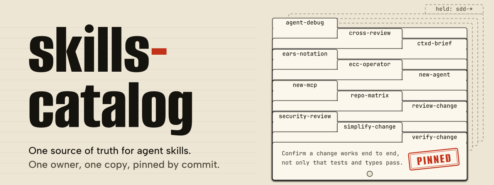
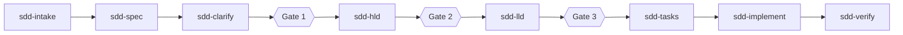

<p align="center">
  
</p>

Every agent skill Kenny writes lives here, once. Each one is a `SKILL.md` folder that Claude Code and Codex both read. Bots pull the catalog at a pinned commit, and a freshness bot checks that each skill still works as the tools around it change.

Status: the design is decided and milestone M1, the catalog and its validation, is under way. The frontmatter linter and its tests are merged. The CI that will run them is not built yet.

## What is in the catalog

The canonical set is 22 skills. Twelve are delivered to consumers and ten are held.

| Skill | Use it when |
| --- | --- |
| [agent-debug](skills/agent-debug/SKILL.md) | An agent loops, stalls, fails tool calls or returns unexpected output |
| [cross-review](skills/cross-review/SKILL.md) | You are reviewing a pull request or posting a comment in Kenny's repos. Codex reviews Claude's work and the reverse, posted as the right bot |
| [ctxd-brief](skills/ctxd-brief/SKILL.md) | You start a session in a ctxd-scoped project and want its brief, open signals and sync state |
| [ears-notation](skills/ears-notation/SKILL.md) | You write or check acceptance criteria in EARS notation |
| [ecc-operator](skills/ecc-operator/SKILL.md) | You set up, approve, start or resume an ECC run, or need to read why one stopped |
| [new-agent](skills/new-agent/SKILL.md) | You scaffold a new Claude agent project |
| [new-mcp](skills/new-mcp/SKILL.md) | You scaffold a new MCP server in Python or Node.js |
| [repo-matrix](skills/repo-matrix/SKILL.md) | You want the health of every repository in a folder: last commit, dirty state, open pull requests |
| [review-change](skills/review-change/SKILL.md) | You review a unit's changes against its specification and acceptance criteria |
| [security-review](skills/security-review/SKILL.md) | A change touches secrets, redaction, network access, storage, auth or untrusted input |
| [simplify-change](skills/simplify-change/SKILL.md) | The change works and its tests pass, and you want to strip needless complexity |
| [verify-change](skills/verify-change/SKILL.md) | Tests pass and you still need to confirm the change works end to end |

Once a change works, three of these run in sequence: simplify-change, then verify-change, then review-change.

## Held skills

Ten `sdd-*` skills for spec-driven development are published under [`.held/`](.held). They pass the same checks as every other skill, and no consumer reads them until the SDD switch gate passes (DESIGN 3.2).



Two more sit outside that line. `sdd-triage` classifies support work by severity from S0 to S4 and places it in the queue. `sdd-adopt` brings the framework into an existing application without breaking it.

## How it will work

- **Catalog.** `skills/<name>/SKILL.md`, one folder per skill, and the folder name equals the frontmatter `name`.
- **Bots** read the catalog as a git submodule at `.agents/skills/shared`, pinned to a commit and moved forward by reviewed bump PRs. Relative links under `.claude/skills/` make the skills visible to Claude Code.
- **Interactive agents** read skills through a FastMCP server, using `skill://` resources and the experimental Skills extension.
- **The freshness bot** watches Claude Code, Codex, the Agent Skills spec, FastMCP and the model lists. It checks every skill nightly and on every pull request, and it runs behavioral evals on the Mac only when something changed, through the bots' own CLIs. Findings become pull requests and issues. Alerts are issues that iwb can pick up, plus a Slack message.
- **Third-party skills stay out.** They can be promoted after review, with provenance, a license and a pinned source sha.

### Roadmap

| Milestone | Scope | State |
| --- | --- | --- |
| M1 | The catalog and its validation CI | In progress |
| M2 | Freshness bot, static checks, upstream watch and alerting | Planned |
| M3 | Submodule rollout to one canary consumer | Planned |
| M4 | The MCP server | Planned |
| M5 | Bump-PR automation, and joining the iwb pipeline | Planned |
| M6 | Behavioral evals for Claude and Codex | Planned |
| M7 | Third-party search index | Optional |

The requirements and acceptance criteria for each milestone are in [docs/SPEC.md](docs/SPEC.md).

## Anatomy of a skill

This is the frontmatter of `verify-change`, as of this writing.

```yaml
---
name: verify-change
description: Confirm a change actually works end to end, not only that tests and types pass. Use after the acceptance commands and the fast gate named in AGENTS.md pass, before review or handoff.
metadata:
  catalog-version: "1.2.0"
  catalog-owner: "ecc-customization"
  catalog-provenance: "own"
  catalog-targets: "claude,codex"
  catalog-last-verified: "2026-11-11"
  catalog-max-age-days: "90"
  catalog-requires: "git"
---
```

Top-level fields are limited to the six that the Agent Skills spec defines: `name`, `description`, `license`, `compatibility`, `metadata` and `allowed-tools`. Catalog fields sit under `metadata` as strings. Every description opens with the main use case and includes a "Use when" sentence. The freshness bot advances `catalog-last-verified`, so nobody edits it by hand.

## Working in this repository

Check the catalog before committing:

```sh
python3 tools/lint.py                   # lint: 22 skills, 0 findings
python3 -m unittest discover -s tests   # Ran 44 tests ... OK
```

The inventory of skills on the owner's machine is generated, so regenerate it rather than editing it:

```sh
python3 tools/inventory.py --help
```

The script needs Python 3.9+ and `gh` for repository visibility. Skills named in the owner's untracked local exclusion list, `~/.config/skills-catalog/exclude.txt`, are skipped entirely (DESIGN 5.1). `--offline --visibility file.json` skips `gh`. Judgment calls go in `inventory/decisions.json` and `inventory/provenance-overrides.json`, not in the generated files.

This repository is public, so everything committed here is published. Read [AGENTS.md](AGENTS.md) before contributing. It covers what must never be committed, how held skills move, and the scrub check to run first.

## Documents

| Document | What it is |
| --- | --- |
| [docs/DESIGN.md](docs/DESIGN.md) | Decisions, architecture, held skills, the freshness bot and its alerts, the security model and rejected alternatives |
| [docs/SPEC.md](docs/SPEC.md) | Requirements and EARS acceptance criteria for milestones M1 to M7 |
| [inventory/own-skills.md](inventory/own-skills.md) | Every own skill found on the machine, duplicate clusters, and the proposed canonical set |
| [inventory/own-skills.json](inventory/own-skills.json) | The same, machine-readable |
| [AGENTS.md](AGENTS.md) | How agents work in this repository |

## License

MIT for the catalog's own content, once a `LICENSE` is added in M1. Promoted third-party skills keep their own license beside them.
